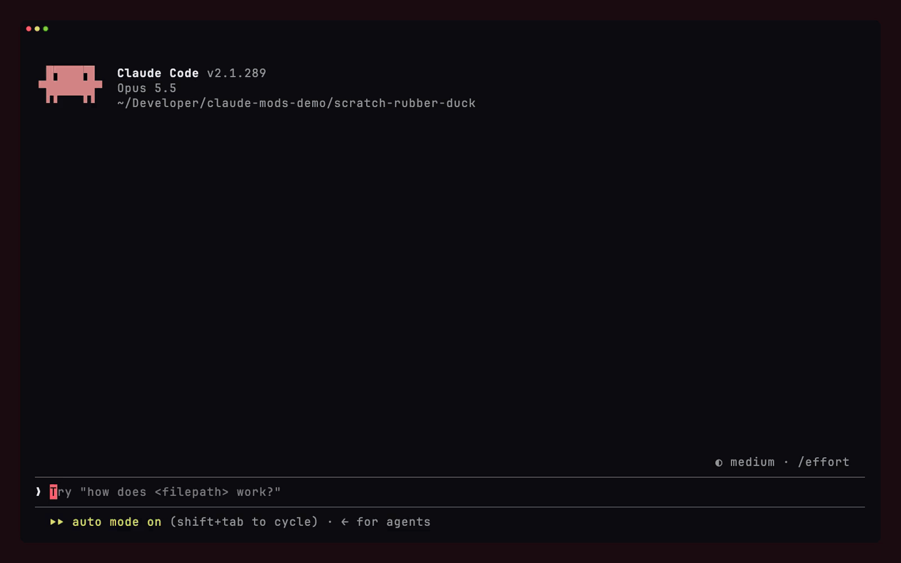
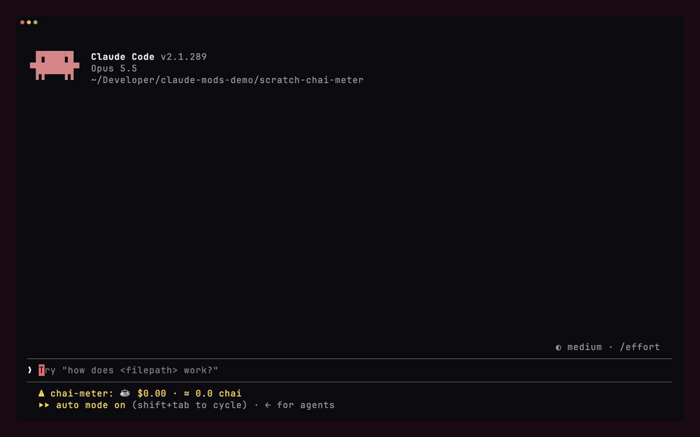
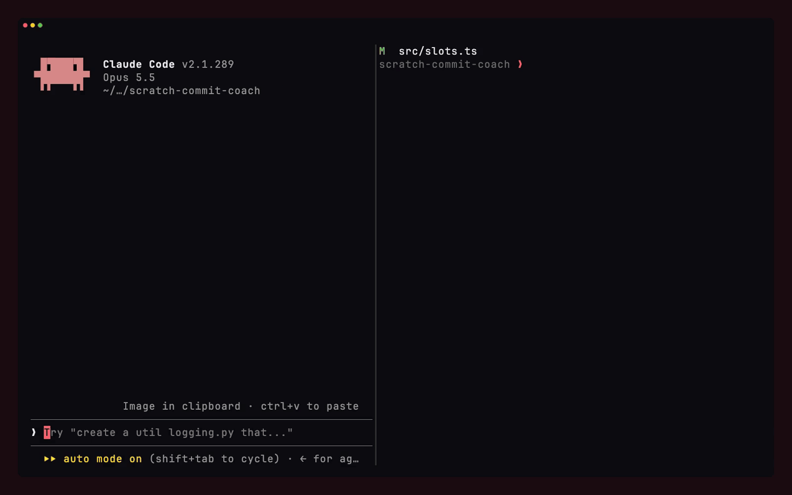
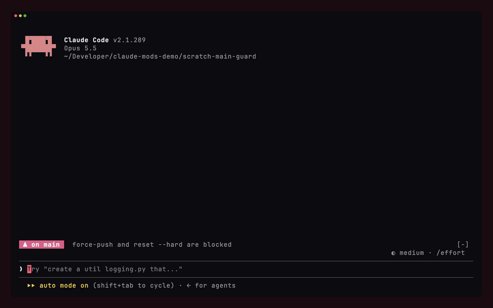

# claude-mods

Ten Claude Code mods I built in a day. Each one is a small TypeScript plugin of function hooks, in its own folder, with a README and tests.

| Mod | What it does |
| --- | --- |
| [phone-approve](phone-approve) | Approve or deny permission prompts from Telegram. The terminal prompt still works as a fallback. |
| [secret-guard](secret-guard) | Stops Claude from writing API keys, tokens, private keys and database passwords into files. |
| [rubber-duck](rubber-duck) | A small, fast model reads every edit and flags one real concern, if there is one. |
| [chai-meter](chai-meter) | A taxi meter for the session's cost in the status line, in dollars and cups of chai. |
| [commit-coach](commit-coach) | Turns `git commit -m "fix"` into a conventional commit written from the staged diff, and strips attribution trailers. |
| [main-guard](main-guard) | A red band when you're on main or in prod. No force push or `reset --hard` on protected branches. |
| [night-mode](night-mode) | Between 1am and 5am, Claude gets more careful and asks before deploys, force pushes and `rm -rf`. |
| [ship-log](ship-log) | `/ship` turns what you built this session into a build-in-public post for X or LinkedIn. |
| [standup](standup) | `/standup` writes yesterday's standup from your commits and copies it. |
| [whoopgate](whoopgate) | Live WHOOP heart rate in the status line. Risky commands are blocked while it's over your limit. |

## Try one

```sh
git clone https://github.com/ShriD5/claude-mods
claude --plugin-dir ./claude-mods/secret-guard
```

Pass `--plugin-dir` once per mod to load several. Each mod's README lists its options.

Want a different behaviour? Open the folder in Claude Code and ask it to change the mod. That's most of the fun.

## Demos

**secret-guard** blocks a hardcoded Stripe key, and Claude moves it to an env var on its own:


**rubber-duck** notices that removing a try/catch also changed a public signature:



**chai-meter** ticks up while the answer streams:



**commit-coach** rewrites a lazy commit message:



**main-guard** refuses a force push to main:



## Checking a mod

```sh
claude plugin validate ./<mod>
claude plugin test ./<mod>
```

Built against Claude Code 2.1.289. The mods API is early access and may change between releases.

MIT licensed.
